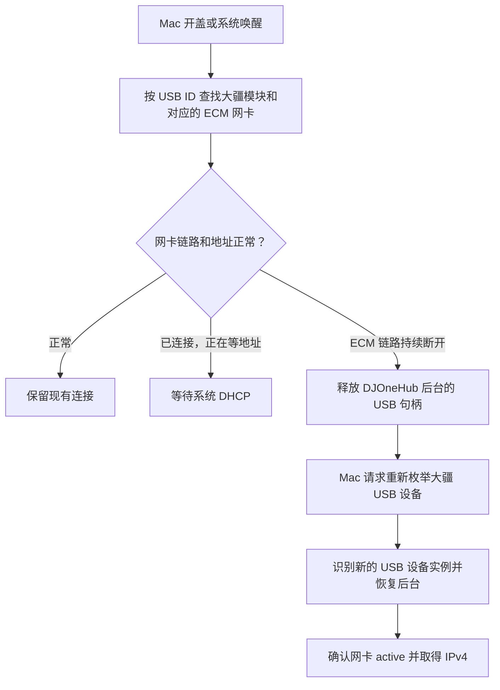

# Mac 开盖后恢复大疆 4G USB 网卡

大疆第一代 4G 模块以 USB 网卡接入 Mac 后，有时会在合盖休眠、重新开盖时断网。这个工具在开盖或系统唤醒后检查 **大疆模块的 CDC-ECM 网卡**。确认链路持续断开时，Mac 只对这块 USB 设备发起重新枚举，让网卡重新出现并获取地址。SwiftBar 插件显示连接状态、LTE 信号和重连记录。

## 断连发生在哪一层

真机故障现场有三个现象：

1. USB 树里仍有 `EG25G-QDC507`（`2ca3:4006`），下挂的 `AppleUserECM` 驱动和网卡也仍存在。USB 设备对象的登记 ID 与休眠前一致。
2. `ifconfig` 显示该网卡的 `status: inactive`，没有 IPv4 地址。把网卡执行一次 `down` / `up` 后，仍然是 `inactive`。
3. 暂停 DJOneHub 后台以释放 USB 句柄时，网卡仍处于断开状态。调用 Mac 的 `USBDeviceReEnumerate` 后，USB 登记 ID 改变，网卡恢复 `active` 并取得 DHCP 地址。DJOneHub 重启后台之前，网卡已经恢复。绑定这张网卡发起的 HTTPS 请求返回了 200。

这里能确认的是 **休眠恢复后，USB 网卡对象还在，ECM 链路却没有恢复**。链路断开时无法正常完成 DHCP，单独续租并不能重建这个链路。可能涉及 Mac 驱动与模块固件在唤醒时的链路状态同步。具体是哪条 USB 控制消息或通知出了问题，需要 USB 抓包进一步确认。

## 恢复流程



已知的 USB 设备在开盖后持续断开约 1 秒时进入恢复。新出现的设备会观察更久，已建立链路的网卡优先等待 DHCP。盖子仍合上、模块未插入或未进入 ECM 上网模式时，工具跳过恢复。每次恢复只请求一次 USB 重新枚举。短暂的独占冲突发生在打开句柄阶段，工具会小范围重试。

工具从 USB 树里查找实际网卡，接口名可以是 `en8` 或其他编号。它只会暂停当前账户下、且确认为 USB 持有者的 DJOneHub LaunchAgent（`com.jamie.djonehub`）。USB 重新枚举针对模块的 USB 接口，整个过程保持物理连接，也无需发送 `AT+CFUN=1,1` 重启模块。

**已验证环境**为 Apple Silicon MacBook Air、macOS 27.2.1、第一代 QDC507 模块、DJOneHub-mac-enhanced 1.2.10 和 SwiftBar 2.1.1。加速版的一次真实开盖测试记录为 **4 秒**，具体用时取决于网卡枚举和 DHCP。当前的后台释放流程匹配增强版的 LaunchAgent。其他应用或不匹配的 DJOneHub 后台占用 USB 时，工具会报告占用，方便手动排查。

## 安装

1. 用 [DJOneHub-mac-enhanced](https://github.com/rogerbush007-a11y/DJOneHub-mac-enhanced) 将大疆模块切到上网模式，确认 Mac 可以经模块正常上网。
2. 安装 [SwiftBar](https://github.com/swiftbar/SwiftBar)，首次打开后选择一个插件文件夹。安装程序也需要 Apple 的 Xcode Command Line Tools 用于本机编译。
3. 从仓库的 **Code → Download ZIP** 下载并解压，在解压后的目录运行：

   ```bash
   /bin/bash install.sh
   ```

安装在当前账户下运行。安装路径是 `~/.dji4g-wake`，唤醒监听器名称是 `local.dji4g.wake`。SwiftBar 插件放入 SwiftBar 当前选中的目录。插着模块合盖一会儿再打开，检查 **DJI → 最近记录**。如果网络本来正常，记录会显示「连接正常」。

## SwiftBar 可视化

菜单栏显示 **DJI**、macOS 窗口按钮风格的连接圆点以及四格信号。图标包含亮色和暗色版本。

| 图标示例 | 状态 | 含义 |
| --- | --- | --- |
|  | 已连接 | ECM 链路正常，Mac 已获取 IPv4 |
|  | 检查或恢复中 | 正在释放 USB 句柄、重新枚举或等待网卡与 DHCP |
|  | 待恢复 | USB 模块仍在，Mac 端网卡链路或地址尚不可用 |
|  | 未启用上网 | 模块未插入或未处于 ECM 上网模式 |

- 连接状态每 **0.5 秒**采样，只有菜单内容变化才重画。实测在稳定连接时，DJI 插件与采样进程合计约 **0.1% 单核 CPU、6.9 MiB 内存**，取样 20 秒，未计 SwiftBar 主程序。
- 信号每 **2 秒**通过 DJOneHub 的本机接口查询 `AT+QCSQ`。四格按 LTE RSRP 估算，菜单显示 dBm 原值。USB 恢复期间暂停查询，读取失败后约 10 秒重试。LTE 信号正常时，Mac 端 USB 网卡仍可能处于断开状态。
- 下拉菜单有网卡、IPv4 地址、**立即重连**、最近五条记录和诊断日志入口。「立即重连」会短暂断开大疆 USB 网卡，可用于单独验证重新枚举。

## 诊断与日志

下面两条命令可用来区分 USB 设备消失、ECM 网卡消失和网卡链路断开。把 `en8` 换成第一条输出中属于该模块的接口名。

```bash
ioreg -p IOService -r -n EG25G-QDC507 -w0 | grep -E 'EG25G|AppleUserECM|EthernetInterface'
ifconfig en8 | grep -E 'inet |status:'
```

`~/.dji4g-wake/state/history.log` 保存唤醒和重连结果，`technical.log` 保存 USB 返回码。两份文件各自超过 32 KiB 时裁剪到 24 KiB 以内，保留最新完整记录。状态采样和信号查询不逐次追加日志。监听器使用 macOS 系统日志，在「控制台」可按 `local.dji4g.wake` 搜索。

如果 USB 树里完全看不到模块，Mac 就没有可操作的设备句柄，工具无法从主机端发起重枚举。如果只是看到 `status: active` 但地址未到，应等系统完成 DHCP，再根据日志定位。

## 卸载

等 DJI 状态结束检查或重连后，在终端运行：

```bash
launchctl bootout "gui/$(id -u)/local.dji4g.wake"
rm -f "$HOME/Library/LaunchAgents/local.dji4g.wake.plist"
rm -f "$(defaults read com.ameba.SwiftBar PluginDirectory)/dji4g.10s.sh"
```

如果也要删除工具文件和日志，再单独删除 `~/.dji4g-wake`。

## 参考

- [DJOneHub 增强版问题 #26](https://github.com/rogerbush007-a11y/DJOneHub-mac-enhanced/issues/26)记录了增强版下的合盖复现现象。
- [DJOneHub 的相关问题 #15](https://github.com/ZenGeekLabs/DJOneHub/issues/15)和[唤醒恢复 PR #14](https://github.com/ZenGeekLabs/DJOneHub/pull/14)记录了相似症状。该 PR 使用整机模块重启。
- [数源 5G 通信壳唤醒修复](https://github.com/MARINE4th/mac-usb-5g-wake-fix)使用 ADB 在设备端重绑 USB，并提供了 SwiftBar 状态栏设计的参考。
